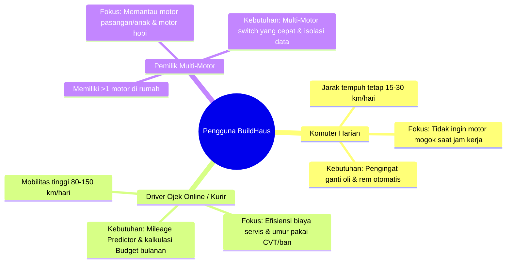
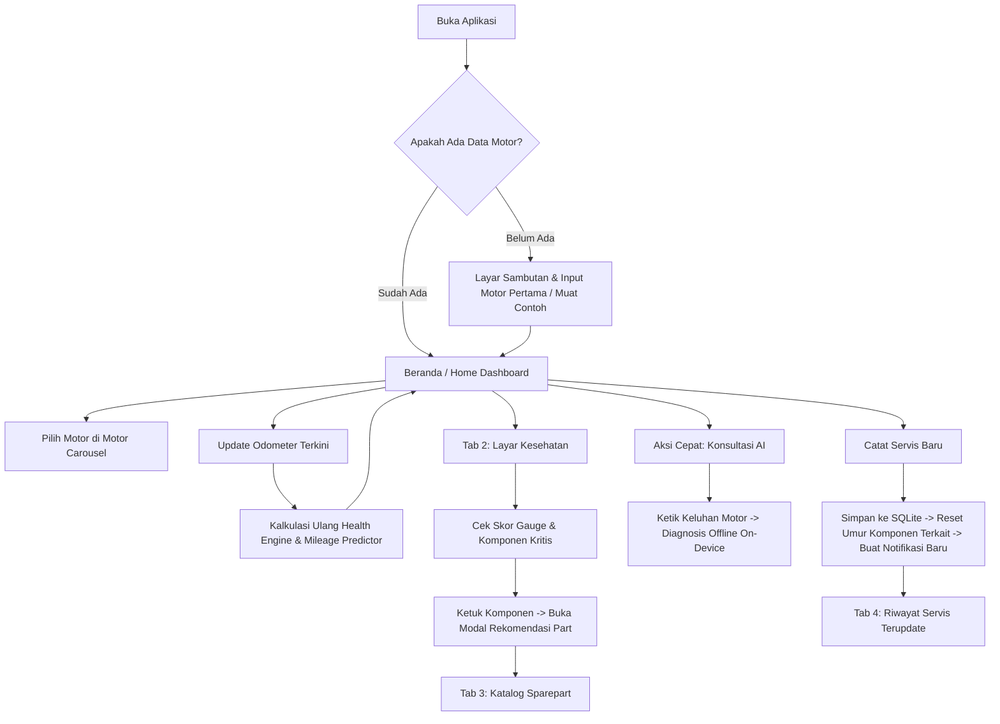

# PRODUCT REQUIREMENTS DOCUMENT (PRD) — BUILDHAUS

**Nama Produk:** BuildHaus  
**Versi Dokumen:** 1.0 (Final Draft)  
**Tanggal:** 27 Oktober 2026  
**Status:** Approved for Implementation & Prototyping  
**Platform Target:** Android Mobile App (Flutter Native, Offline-First)  

---

## 1. RINGKASAN EKSEKUTIF (EXECUTIVE SUMMARY)

**BuildHaus** adalah aplikasi manajemen perawatan sepeda motor mandiri berbasis Android dengan arsitektur **100% Offline-First**. Aplikasi ini dirancang khusus untuk pengendara sepeda motor di Indonesia yang menginginkan pencatatan perawatan yang teratur, estimasi keausan suku cadang berbasis data riwayat, transparansi harga servis, serta konsultasi diagnosis mekanik cerdas langsung di perangkat (*on-device AI*) tanpa memerlukan koneksi internet, tanpa login akun cloud, dan tanpa pelacakan data pribadi.

### Visi Produk
Menjadi asisten digital perawatan sepeda motor paling andal, transparan, dan privat yang membantu pemilik kendaraan menghemat biaya operasional, mencegah kerusakan mendadak di jalan raya, dan menjaga nilai jual kembali (*resale value*) sepeda motor mereka.

---

## 2. LATAR BELAKANG & TUJUAN PRODUK (PROBLEM & OBJECTIVES)

### 2.1 Masalah Pengguna (Problem Statement)
1. **Lupa Jadwal Perawatan Rutin:** Pengendara sering kali hanya mengandalkan ingatan atau stiker servis yang mudah pudar/hilang, sehingga terlambat mengganti oli mesin, oli gardan, atau kampas rem.
2. **Asimetri Informasi Biaya & Suku Cadang:** Banyak pemilik motor merasa cemas saat datang ke bengkel karena ketidakjelasan kisaran biaya jasa serta harga resmi (HET) suku cadang yang dibutuhkan.
3. **Ketergantungan Internet & Privasi:** Sebagian besar aplikasi manajemen kendaraan yang ada mengharuskan registrasi akun, sinkronisasi server yang lambat, boros kuota, dan rentan terhadap kebocoran data mobilitas pengguna.
4. **Gejala Kerusakan Sulit Dipahami:** Pengendara awam kesulitan menerjemahkan gejala motor (misal: bunyi berdecit saat rem ditekan, atau tarikan motor berat) menjadi tindakan servis yang tepat sebelum terjadi kerusakan fatal.

### 2.2 Tujuan Produk (Goals)
- Menyediakan aplikasi pencatatan servis dan pemantauan kondisi fisik kendaraan yang dapat diakses seketika tanpa koneksi internet (*zero network dependency*).
- Menghitung estimasi skor kesehatan suku cadang (*Component Health Score*) secara matematis berdasarkan kombinasi jarak tempuh aktual, interval waktu, profil penggunaan, dan riwayat servis.
- Membantu pengguna merencanakan anggaran bulanan servis (*Budget Engine*) yang terintegrasi langsung dengan katalog suku cadang resmi.
- Menyediakan asisten mekanik berbasis AI lokal (*llama.cpp on-device*) dengan *safety guardrail* yang mengutamakan keselamatan berkendara.
- Memastikan performa aplikasi sangat ringan (ukuran download APK < 35 MB, instalasi cepat, startup time < 1,5 detik).

### 2.3 Hal yang Di Luar Lingkup (Non-Goals)
- BuildHaus **bukan** marketplace e-commerce untuk transaksi jual-beli suku cadang secara online.
- BuildHaus **bukan** platform booking bengkel online atau layanan antar-jemput montir.
- BuildHaus **tidak** mengumpulkan analitik data pengguna ke server cloud pihak ketiga.

---

## 3. KEBUTUHAN & TARGET PENGGUNA (USER PERSONAS)



### Karakteristik & Pain Points:
1. **Andi (26 tahun) — Komuter Kantor Harian:**
   - *Pain Point:* Sering lupa kapan terakhir kali servis CVT dan ganti oli hingga motor terasa bergetar parah.
   - *Kebutuhan:* Kartu ringkasan kesehatan di halaman utama dan notifikasi lokal saat jarak tempuh mendekati batas servis.
2. **Budi (34 tahun) — Driver Logistik / Ojek Online:**
   - *Pain Point:* Pendapatan harian harus dialokasikan secara cermat; takut boncos jika bengkel menawarkan suku cadang yang belum perlu diganti.
   - *Kebutuhan:* Fitur *Budget Planner* untuk memisahkan suku cadang yang "Terdanai Bulan Ini" vs "Bisa Ditunda", serta katalog referensi HET.
3. **Denny (42 tahun) — Kepala Keluarga / Pemilik 3 Motor:**
   - *Pain Point:* Mengelola jadwal servis untuk Vario istrinya, Beat anaknya, dan Aerox miliknya sendiri.
   - *Kebutuhan:* Fitur *Multi-Motor Selector* satu ketukan tanpa data antar-motor bercampur aduk.

---

## 4. FITUR UTAMA & SPESIFIKASI FUNGSIONAL

```
┌────────────────────────────────────────────────────────────────────────┐
│                        BUILDHAUS FEATURE SUITE                         │
├─────────────────────┬───────────────────────┬──────────────────────────┤
│ 1. KENDARAAN & ODO  │ 2. HEALTH & INSPECT   │ 3. BUDGET & KATALOG      │
│ • Multi-Motorcycle  │ • Component Health    │ • Smart Sparepart        │
│ • Quick Switcher    │ • Mileage Predictor   │ • 2-Tier Priority Match  │
│ • Odo Log Tracker   │ • Self-Inspection     │ • Service Budget Planner │
├─────────────────────┴───────────────────────┴──────────────────────────┤
│ 4. OFFLINE AI ASSISTANT & SECURITY ENGINE                              │
│ • On-Device Llama.cpp (Qwen3 GGUF)    • Safety Red-Flag Enforcement    │
│ • Local Encrypted Backup (AES-256)    • Offline Push Notifications     │
└────────────────────────────────────────────────────────────────────────┘
```

### 4.1 Modul Kendaraan (Multi-Motorcycle Management)
- Pengguna dapat menambah, mengedit, dan menghapus profil sepeda motor.
- Data motor mencakup: Nama Panggilan, Model/Tipe Resmi (Honda, Yamaha, Suzuki, Kawasaki), Nomor Polisi, Tahun Pembuatan, dan Profil Penggunaan (*santai, normal, berat/ojol*).
- Komponen pemilih motor horizontal (*Motor Selector Carousel*) di Beranda yang memungkinkan perpindahan konteks motor aktif secara instan.

### 4.2 Modul Odometer & Prediksi Jarak Tempuh (Mileage Predictor)
- Pencatatan log kilometer terbaru dengan validasi konsistensi (odometer baru tidak boleh lebih kecil dari log sebelumnya).
- *Engine Kalibrasi Otomatis:* Menghitung rata-rata laju km/minggu dan km/bulan setelah melewati masa pembelajaran 3 periode bulanan untuk memprediksi tanggal jatuh tempo servis berikutnya secara akurat.

### 4.3 Modul Kesehatan Komponen (Component Health Engine)
- Menilai kondisi kesehatan komponen utama: Oli Mesin, Oli Gardan, Busi, Filter Udara, Kampas Rem Depan/Belakang, Ban, V-Belt/Rantai, Aki, dan Cairan Radiator.
- Algoritma skor 0–100% berdasarkan jarak tempuh sejak servis terakhir, usia pakai komponen, dan bobot profil penggunaan.
- Tampilan status visual: **Sangat Baik / Baik (Hijau)**, **Periksa (Kuning/Oranye)**, dan **Ganti / Bahaya (Merah)**.
- Banner Pemeriksaan Mandiri (*Self-Inspection Checklist*) untuk deteksi dini gejala fisik (rem blong, ban botak, lampu mati).

### 4.4 Modul Katalog Suku Cadang Pintar (Smart Sparepart Catalog)
- Katalog referensi suku cadang resmi dengan informasi kategori, merek suku cadang, dan estimasi Harga Eceran Tertinggi (HET).
- **Sistem Prioritas 2-Tingkat (2-Tier Recommendation):**
  - *Prioritas 1 (Budget Plan):* Suku cadang yang telah dialokasikan dan disetujui dalam rencana anggaran bulanan motor aktif.
  - *Prioritas 2 (Health Condition):* Suku cadang yang terdeteksi aus atau memerlukan penggantian berdasarkan skor kesehatan komponen.
- Pencarian cerdas teks dan penyaringan kategori (*Oli, Rem, Mesin, Transmisi, Kaki-kaki*).

### 4.5 Modul Riwayat Servis & Pengingat (Service History & Reminders)
- Pencatatan riwayat servis lengkap: Tanggal servis, Nama Bengkel, Catatan Pekerjaan, Kilometer saat servis, dan Total Biaya.
- Tab Riwayat Servis, Log Odometer historis, dan Jadwal Pengingat Aktif.
- Notifikasi lokal Android (*Local Scheduled Notifications*) yang terjadwal otomatis tanpa memerlukan koneksi internet atau server push.

### 4.6 Modul Konsultasi AI Offline (AI Health Assistant)
- Chatbot mekanik pintar yang berjalan langsung pada hardware ponsel menggunakan *llama.cpp* dan model bahasa *Qwen3 GGUF*.
- Mengambil konteks otomatis dari motor aktif (model, kilometer terkini, status komponen kritis).
- *AI Safety Guard:* Menolak memberikan saran perbaikan berisiko tinggi secara mandiri jika terdeteksi bahaya keselamatan (misal: kebocoran minyak rem atau rem blong) dan langsung menyarankan rujukan ke bengkel resmi terdekat.

### 4.7 Modul Cadangan & Pemulihan (Encrypted Backup & Restore)
- Fitur ekspor seluruh basis data ke dalam satu berkas terenkripsi kuat **AES-256-GCM** dengan perlindungan kata sandi pengguna.
- Fitur impor dan verifikasi integritas data cadangan tanpa risiko kerusakan basis data lokal.

---

## 5. ALUR PENGGUNAAN (USER FLOW & STORYBOARD)



---

## 6. PERSYARATAN TEKNIS & ARSITEKTUR SISTEM

| Komponen | Spesifikasi & Teknologi yang Digunakan |
| :--- | :--- |
| **Framework Frontend** | Flutter SDK (Dart) dengan arsitektur modular per fitur (*Feature-First*) |
| **State Management** | Flutter Riverpod (Notifier & AsyncNotifier) |
| **Navigasi** | GoRouter dengan `StatefulShellRoute.indexedStack` (5 Tab Utama) |
| **Local Database** | Drift ORM (SQLite Engine), migrasi schema teruji, ACID-compliant |
| **Machine Learning / AI** | Android Native NDK + `llama.cpp` + model Qwen3 quantized GGUF |
| **Kriptografi & Backup** | AES-256-GCM dengan Password-Based Key Derivation (PBKDF2) |
| **Notifikasi** | `flutter_local_notifications` dengan dataset zona waktu teroptimasi |
| **Ukuran Binary APK** | Universal Release APK < 32 MB; Split ARM64 APK < 13 MB |
| **Kompatibilitas OS** | Android 8.0 (API level 26) hingga Android 14+ (API level 34) |

---

## 7. KRITERIA PENERIMAAN (ACCEPTANCE CRITERIA)

### AC-01: Alih Motor pada Beranda
- **Given:** Pengguna memiliki lebih dari 1 sepeda motor yang terdaftar.
- **When:** Pengguna mengetuk kartu motor kedua pada *Motor Selector Carousel*.
- **Then:** Kartu motor utama, odometer, ringkasan skor kesehatan, dan rekomendasi suku cadang langsung berganti ke motor terpilih dengan transisi animasi halus (< 300 ms) tanpa memicu reload database berulang.

### AC-02: Pencatatan Servis & Pembaruan Skor Kesehatan
- **Given:** Komponen "Oli Mesin" berstatus "PERIKSA" dengan skor < 50%.
- **When:** Pengguna mencatat servis baru dengan tindakan penggantian oli mesin dan menyimpan data.
- **Then:** Skor kesehatan komponen "Oli Mesin" otomatis ter-reset kembali ke 100% ("NORMAL/PRIMA"), log riwayat servis bertambah, dan tanggal pengingat ganti oli berikutnya dijadwalkan ulang.

### AC-03: Prioritas Katalog Suku Cadang (Smart Catalog)
- **Given:** Motor aktif memiliki anggaran servis rem yang telah dialokasikan pada Budget Planner.
- **When:** Pengguna membuka tab *Katalog Sparepart* dengan filter urutan "Rekomendasi".
- **Then:** Suku cadang kampas rem yang terdanai anggaran wajib muncul pada posisi teratas (*Tier 1 — Budget Funded*) dengan label hijau sebelum suku cadang lainnya.

### AC-04: Inferensi AI Offline & Safety Guardrail
- **Given:** Perangkat pengguna berada dalam mode pesawat (*Airplane Mode / Tanpa Internet*).
- **When:** Pengguna mengirim pesan konsultasi keluhan "Rem depan saya tidak pakem dan ada minyak bocor di piringan".
- **Then:** AI lokal memberikan respons peringatan bahaya keselamatan berlatar merah/kritis, melarang motor dikendarai kencang, dan merekomendasikan perbaikan segera ke bengkel resmi.

---

## 8. PERTANYAAN TERBUKA & RENCANA PENGEMBANGAN (FUTURE ROADMAP)

1. **OCR Nota Bengkel:** Kemampuan membaca struk servis fisik secara offline menggunakan on-device OCR untuk pencatatan otomatis tanpa ketik manual.
2. **Audio Diagnosis Engine:** Pengenalan suara derit mesin atau transmisi CVT menggunakan model audio kecil untuk membantu deteksi dini kerusakan laher atau roller CVT.
3. **Penyimpanan Multi-Platform:** Menjaga kesiapan arsitektur (*clean architecture*) agar dapat di-porting ke platform iOS atau Web PWA di masa mendatang jika diperlukan.
